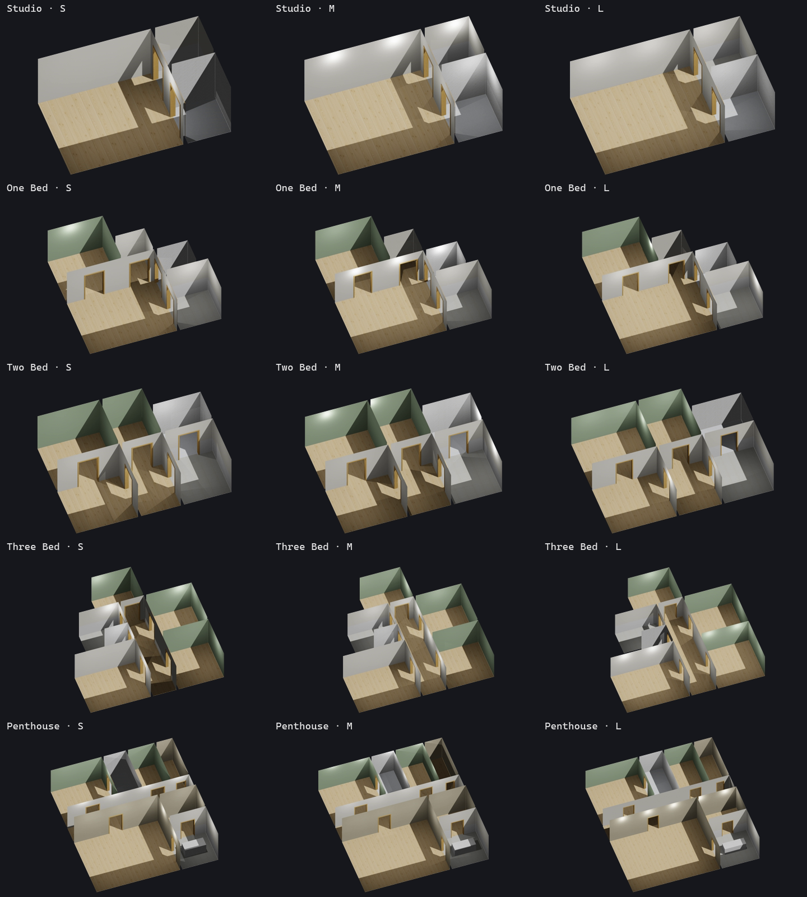

# Free FiveM Apartment Shells: 15 Housing Shells for QBCore, ESX and ps-housing

**15 free, textured FiveM housing shells** for your GTA V roleplay server. There are five apartment floor plans, from a studio flat to an eight-room penthouse, and each plan comes in small, medium and large. Drop-in configs are included for **ps-housing**, **qb-houses (qb-interior)** and **qb-apartments**, and the shells work with any **QBCore**, **Qbox** or **ESX** housing script that spawns shell models. There are builds for both **GTA V Enhanced** and **Legacy**. One resource, about 7 MB, with no Rockstar assets.

Every interior pictured was created using **[MLO Studio](https://gum.co/u/itfzpfoh)**.

---

## Made with MLO Studio

I built every shell in this pack with **[MLO Studio](https://gum.co/u/itfzpfoh)**, my FiveM interior builder. You draw rooms like a floor plan and click walls to add doors. It exports a streamable MLO or housing shell in seconds. Before it hands the files over, it opens them back up and checks them for fall-through floors, rooms that vanish behind portals, and interiors the game thinks are outside.

* **Two kinds of interior.** Walk-in MLOs (rooms, portals, real base-game doors, windows, stairs) and teleport-in housing shells like these.
* **Your own textures.** Drop in an image and get a game-ready material.
* **Both game builds.** GTA V Enhanced (Gen9) and Legacy (Gen8) export, plus Sollumz XML to finish in Blender.

### [Get MLO Studio on Gumroad →](https://gum.co/u/itfzpfoh)

Questions before you buy? Ask on **[Discord](https://discord.gg/YKAKTQhvEw)**.

---

## What's in the pack

| Model | Shell | Rooms | Footprint | Floor area | Entry offset |
|---|---|---|---|---|---|
| `ajd_apt_studio_s` | Studio Apartment (Small) | 3 | 7.6 × 4.5 m | 34 m² | `vector4(1.7, 1.2, 1, 0)` |
| `ajd_apt_studio_m` | Studio Apartment (Medium) | 3 | 8.4 × 5 m | 42 m² | `vector4(1.85, 1.2, 1, 0)` |
| `ajd_apt_studio_l` | Studio Apartment (Large) | 3 | 9.7 × 5.8 m | 56 m² | `vector4(2.075, 1.2, 1, 0)` |
| `ajd_apt_one_bed_s` | One Bed Apartment (Small) | 5 | 8.8 × 8.1 m | 56 m² | `vector4(2.05, 1.2, 1, 0)` |
| `ajd_apt_one_bed_m` | One Bed Apartment (Medium) | 5 | 9.7 × 9 m | 68 m² | `vector4(2.23, 1.2, 1, 0)` |
| `ajd_apt_one_bed_l` | One Bed Apartment (Large) | 5 | 11.2 × 10.4 m | 91 m² | `vector4(2.53, 1.2, 1, 0)` |
| `ajd_apt_two_bed_s` | Two Bed Apartment (Small) | 6 | 10 × 7.2 m | 68 m² | `vector4(1.35, 1.2, 1, 0)` |
| `ajd_apt_two_bed_m` | Two Bed Apartment (Medium) | 6 | 11 × 8 m | 82 m² | `vector4(1.5, 1.2, 1, 0)` |
| `ajd_apt_two_bed_l` | Two Bed Apartment (Large) | 6 | 12.7 × 9.2 m | 110 m² | `vector4(1.75, 1.2, 1, 0)` |
| `ajd_apt_three_bed_s` | Three Bed Apartment (Small) | 7 | 11.7 × 11.4 m | 98 m² | `vector4(1.1, 1.2, 1, 0)` |
| `ajd_apt_three_bed_m` | Three Bed Apartment (Medium) | 7 | 12.9 × 12.6 m | 118 m² | `vector4(1.2, 1.2, 1, 0)` |
| `ajd_apt_three_bed_l` | Three Bed Apartment (Large) | 7 | 14.9 × 14.5 m | 158 m² | `vector4(1.4, 1.2, 1, 0)` |
| `ajd_apt_penthouse_s` | Penthouse Apartment (Small) | 8 | 11.7 × 12.6 m | 147 m² | `vector4(4.05, 1.2, 1, 0)` |
| `ajd_apt_penthouse_m` | Penthouse Apartment (Medium) | 8 | 13 × 14 m | 182 m² | `vector4(4.5, 1.2, 1, 0)` |
| `ajd_apt_penthouse_l` | Penthouse Apartment (Large) | 8 | 15 × 16.1 m | 242 m² | `vector4(5.2, 1.2, 1, 0)` |

**Floor plans**
* **Studio:** living room, kitchen, bathroom
* **One Bed:** hall, living room, kitchen, bedroom, bathroom
* **Two Bed:** hall, living room, kitchen, two bedrooms, bathroom
* **Three Bed:** hall, living room, kitchen, three bedrooms, bathroom
* **Penthouse:** lounge, dining room, kitchen with a marble island, corridor, master bedroom with en suite, guest bedroom, office

**The finish:** oak floors, porcelain-tiled kitchens with white metro-tile splashbacks, marble bathrooms with hex mosaic floors, sage bedrooms, greige limewash in the penthouse living spaces, and oak door frames throughout. The shells are unfurnished, so you can decorate them your way.

**Built light:** all 15 shells share one texture dictionary, so the whole pack is about 7 MB.

## Install

1. Pick the build that matches your server:
   * **GTA V Enhanced** servers: [`[enhanced]/ajd-apartment-shells`](%5Benhanced%5D/ajd-apartment-shells)
   * **GTA V Legacy** servers: [`[legacy]/ajd-apartment-shells`](%5Blegacy%5D/ajd-apartment-shells)
2. Copy that `ajd-apartment-shells` folder into your server's `resources`.
3. Add `ensure ajd-apartment-shells` to your `server.cfg`, before your housing script.
4. Register the shells with your housing script (below).

## Housing script setup

The **entry offset** is where players appear when they go inside. It is measured from the shell's origin, at ped height (floor + 1 m), with a GTA heading. None of the scripts below rotate the shell, so the offsets go in exactly as they are.

### ps-housing
Paste the entries from [`configs/ps-housing.lua`](configs/ps-housing.lua) into `Config.Shells` in `ps-housing/shared/config.lua`. Each entry links its floor-plan image, so ps-housing shows it in the property menu.

### qb-houses (qb-interior)
1. Paste [`configs/qb-interior.lua`](configs/qb-interior.lua) into `qb-interior/client/main.lua`. It adds one export per shell, such as `CreateAjdTwoBedM`.
2. Follow [`configs/qb-houses.lua`](configs/qb-houses.lua). It adds tiers 101–115 to `getDataForHouseTier` in `qb-houses/client/main.lua`, with stash sizes in `config.lua`.
3. Create a house with the tier you want, for example `/createhouse 250000 108` for the Two Bed (Medium).

### qb-apartments
qb-apartments uses qb-interior's `CreateApartmentFurnished` for every apartment. Add the qb-interior exports above, then swap the two `CreateApartmentFurnished(coords)` calls in `qb-apartments/client/main.lua` for the shell you want. Your export must also return the `clothes`, `stash` and `logout` points, as `CreateApartmentFurnished` does.

### Any other script
Use the model name and entry offset from the table above. [`shells.json`](shells.json) has the same data in machine-readable form. Scripts that store the entry at **foot** level (loaf_housing's offset finder, for example) want `z = 0.0` instead of `1.0`.

## Good to know

* These are **housing shells**, not MLO interiors. Each one is a single model with its collision built in, spawned by your housing script. Like every housing shell, they take the outdoor light and time of day.
* The model's origin is the corner of the floor plan at floor level, and every shell is 3 m tall. Housing scripts spawn shells 25–30 m below the door, which is plenty of room.
* No Rockstar assets are included. Every texture is original.
* Built with [MLO Studio](https://gum.co/u/itfzpfoh), and every shell is verified by reading it back through CodeWalker.

## FAQ

**Are these FiveM shells really free?**
Yes. All 15 are free to use on your server, including servers that make money. See the licence below.

**Do they work with QBCore, Qbox and ESX?**
Yes. A shell is just a streamed model with its collision built in, so any housing or apartment script that spawns shell models can use them. Configs for ps-housing, qb-houses and qb-apartments are included. For other scripts, use the model names and entry offsets in the table.

**What's the difference between a housing shell and an MLO?**
An MLO is a walk-in interior placed in the map, with rooms and portals. A shell is a single model your housing script spawns below the map, and players teleport into it. Shells are what housing scripts use for player houses and apartments. Want a walk-in MLO instead? [MLO Studio](https://gum.co/u/itfzpfoh) builds both.

**Where do I find each shell's door offset?**
In the "Entry offset" column above, and in [`shells.json`](shells.json).

**Can I change the textures or furnish them?**
Yes. Edit them for your own servers as much as you like. To build your own shells and interiors from scratch, use [MLO Studio](https://gum.co/u/itfzpfoh).

## Licence

Free to use on any FiveM server, including monetised ones. You can't sell, re-upload or redistribute the files, or include them in another pack. See [LICENSE.md](LICENSE.md).

## Learn to build your own

* **[MLO Studio](https://gum.co/u/itfzpfoh)**: build shells and MLOs like these in minutes.
* **[Free Sollumz 2.9 guide](https://github.com/AlexJamesDean/sollumz-fivem-guide)**: make FiveM assets by hand in Blender.
* **[The complete Sollumz guide](https://ajthe.dev/SollumzGuide)**: MLOs, YTYPs, YMAPs, vehicles and commercial packaging.

---

**Made by [AJTheDev](https://ajthe.dev/)** · Support and requests on **[Discord](https://discord.gg/YKAKTQhvEw)**
